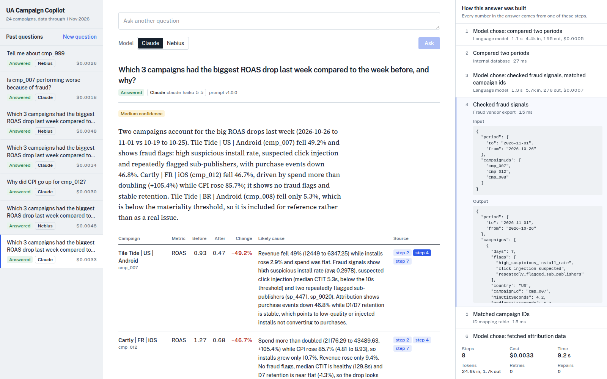
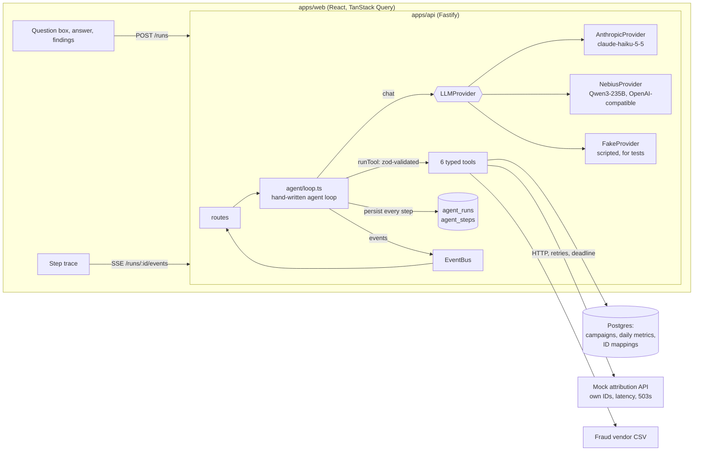
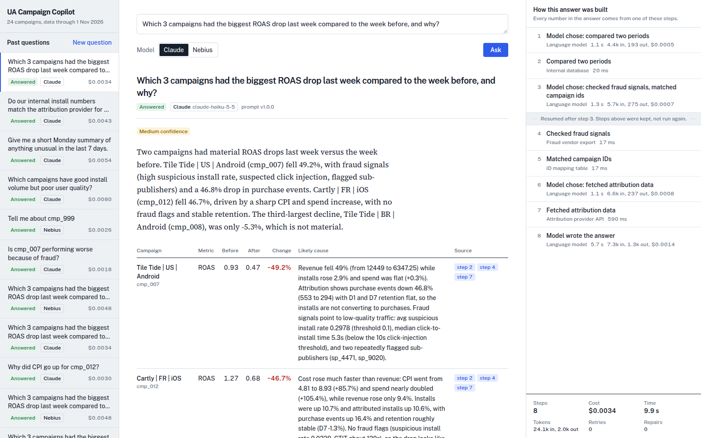

# UA Campaign Copilot

An internal tool for a user acquisition (UA) manager. She asks a question in plain language
("Which 3 campaigns had the biggest ROAS drop last week, and why?") and an AI agent answers by querying three
fragmented sources: the internal Postgres database, an external attribution provider, and a fraud vendor's CSV export.
The answer comes with a findings table and a live trace of every step, so every number can be traced to the
step that produced it.

Full requirements: [`PRD.md`](PRD.md).



## Quick start

```bash
cp .env.example .env               # optional: add ANTHROPIC_API_KEY / NEBIUS_API_KEY (or enter a key in the app)
docker compose up -d               # Postgres 16 (+ a copilot_test database for Vitest)
pnpm install
pnpm db:migrate && pnpm db:seed
pnpm dev                           # API on :3001, web app on http://localhost:5173
```

| Command | What it does |
|---|---|
| `pnpm test` | Unit and integration tests for the API, web and eval scorers (Vitest, needs Postgres) |
| `pnpm e2e` | Playwright end-to-end tests against real servers with the scripted `FakeProvider` |
| `pnpm eval --provider all [--judge]` | Eval suite against real models; writes `evals/reports/<timestamp>.md` and `.json` |
| `pnpm typecheck && pnpm lint` | Strict TypeScript and ESLint across the workspace |
| `pnpm ask "<question>" [--provider nebius]` | Ask the running API from the terminal and follow the run live |
| `pnpm tool <name> '<json>'` | Run a single agent tool against the dev database |
| `pnpm db:reset` | Drop, migrate and reseed the dev database |

### Running without server keys (live demos)

API keys in `.env` are optional. If the server has no key for the selected model, the question box shows an
**API key** field next to the model switch. The key you enter:

- stays in that browser tab only (`sessionStorage`; gone when the tab closes, **Forget key** removes it earlier),
- is sent only with your own requests, in the `x-llm-api-key` header, to this app's API,
- is used for that one run and never written to the database or the logs.

So you can share the app and hand someone a temporary key for a live test. A key in `.env` still takes over when the
field is left empty and stays out of the browser entirely.

### Deployment

- **API and database on Render.** [`render.yaml`](render.yaml) is a Blueprint for the API (Node web service) and a Postgres
  database. On every boot the API runs migrations and the deterministic seed (which also writes the vendor files), then
  starts. No API keys are configured on purpose: the app is public, so users enter a key in the app.
- **Web app on Vercel.** [`vercel.json`](vercel.json) builds `apps/web` and rewrites `/api/*` to the Render API, so the
  browser only ever talks to one origin (no CORS). The same config also lives in
  [`apps/web/vercel.json`](apps/web/vercel.json), so it works whether the Vercel project's Root Directory is the
  repository root or `apps/web`.

To deploy your own copy: in Render choose **New > Blueprint** and select this repository; then point the rewrite
destination in `vercel.json` at the Render URL and import the repository in Vercel (or run `npx vercel --prod`).
Render's free instances sleep when idle, so open the app once a minute before a demo.

## Architecture



**The loop** (`apps/api/src/agent/loop.ts`), in plain words:

1. Rebuild the conversation from the persisted steps. A new run has none; a resumed run has some.
2. Finish whatever the last model turn asked for: run its pending tool calls, or validate its final answer.
3. Check the budgets (LLM steps, total tokens, wall time).
4. Call the provider through `withRetry`, which backs off with jitter on 429/5xx/network errors and never retries 400 or 401.
5. Persist the LLM step *before* acting on it, then execute the requested tools concurrently. Each tool
   result is validated, persisted as its own step, and returned to the model with a `step_N` reference.
6. On a final message, parse the JSON and validate it with zod, with up to 2 repair attempts. Then apply two code-level
   guardrails: the **grounding check** (every before/after number must match a tool output, otherwise confidence
   becomes `low`) and the **data-gap check** (any failed source must appear in the caveats).

The LLM never computes numbers. It chooses tools and parameters and explains the results; aggregation happens in SQL
and in the tools.

### Tools

| Tool | Source | Purpose |
|---|---|---|
| `list_campaigns` | Postgres | Find campaigns by filters or by name (`search`), check status and last active date |
| `get_campaign_metrics` | Postgres | Totals or daily spend, clicks, installs, revenue, CPI, ROAS |
| `compare_campaign_periods` | Postgres | Before/after values with absolute and % changes, ranked by a metric |
| `resolve_campaign_id` | Postgres mapping | `cmp_...` <-> `af_...`: the sources disagree on IDs |
| `get_attribution_data` | Mock vendor API over HTTP | Attributed installs, D1/D7 retention, purchases, discrepancy vs internal installs |
| `get_fraud_signals` | Vendor CSV | Suspicious install rate, click-to-install time, flagged sub-publishers, ready-made flags |

Outputs are compact (at most 50 rows, flagged when truncated). Input and output schemas live in
`packages/shared/src/schemas/tools.ts`; the JSON schemas the LLM sees are generated from the same zod schemas.

## Key design decisions

1. **Typed tools instead of generated SQL.** Generated SQL is the classic brittle prompt chain: it breaks on schema
   changes, is hard to evaluate, and is a security risk. Six parameterised tools behave the same across models, have
   unit tests against the seeded database, and their outputs are validated with zod. When an eval showed that Nebius
   could not find a campaign by name, the fix was a `search` parameter on `list_campaigns`, not a prompt trick.
2. **Provider abstraction with normalised messages.** `LLMProvider` has one method, `chat()`, and one internal message
   format. The Anthropic adapter (native tool use, adaptive thinking whose blocks are replayed verbatim) and the Nebius
   adapter (OpenAI-compatible function calling) translate to and from it. Switching models is a config change, proven
   by running the same 17 eval cases on both providers.
3. **Schema-first outputs with a repair loop and grounding check.** The final answer must match the `FinalAnswer`
   zod schema. Invalid answers get up to 2 repair prompts listing the exact zod errors, and are then marked
   `failed_validation`; the UI shows the raw text as a warning, never as an answer. Numbers that do not match any tool
   output lower confidence to `low`, and missing data is always reported in the caveats.
4. **Persist before proceed.** Every LLM call, tool call and repair is a row in `agent_steps`, written before the next
   LLM call. New and resumed runs share one code path that rebuilds state from those rows, so a crash anywhere is
   resumable and completed tool calls never run again. Runs left "running" by a dead server are marked resumable on
   the next start.
5. **Deterministic seed with documented anomalies.** A fixed-seed generator produces 24 campaigns over 60 days ending on
   a fixed date (2026-11-01, so "last week" never moves) and injects the scenarios S1 to S6. `scenarios.ts` holds both the
   injection parameters and the expected findings, and is imported by the seed, the tests and the evals.
6. **FakeProvider for deterministic agent tests.** A scripted `LLMProvider` drives the loop tests (happy path, invalid tool
   input, tool exceptions, repair, every budget, retries, resume after a crash, resuming a partly finished parallel
   batch) and the E2E suite. The agent loop is tested like any other code path, without API keys.

Other decisions worth knowing:

- **Cheap models by default.** `claude-haiku-5-5` ($0.10/$0.50 per 1M tokens) at low effort, and Nebius
  `Qwen/Qwen3-235B-A22B-Instruct-2507` ($0.20/$0.60), chosen from the tool-capable models listed by Token Factory's
  `/v1/models`. Median cost per run is about $0.003.
- **Token budget raised from 50k to 120k.** Each call resends the conversation, so broad questions needed 55 to 65k tokens
  and ran out before answering. 120k costs at most about $0.012 per run on Haiku.
- **Vendor outages degrade instead of failing.** The attribution tool retries each campaign and stops waiting shortly
  before the tool timeout, returning partial results plus `dataGaps` rather than being killed and losing everything.
- **zod 4's `z.toJSONSchema`** replaces `zod-to-json-schema` (named in the PRD), which does not support zod 4.
- **Evals and E2E use their own freshly seeded databases** (`copilot_eval`, `copilot_e2e`), so they are repeatable
  and never touch dev data or history.

## Evals

```bash
pnpm eval --provider all --judge              # 17 cases x 2 providers, about $0.15 (incl. judge) and 2 minutes
pnpm eval --provider anthropic --cases S1,adv-unknown-campaign
```

There are 17 cases in `evals/cases/` (one file each). They cover scenarios S1 to S6, plus adversarial cases: an unknown
campaign id, an ambiguous question, the attribution API down, and a period after the data ends. Each case states the
campaigns that must appear, the direction of change, cause keywords, campaigns that must not be flagged, required
tools and a step limit. Scorers:

- **expectations**: right campaigns, direction, cause and caveats, with nothing invented.
- **numeric**: every before/after number is within ±2% of ground truth computed *independently* from SQL and the raw
  vendor files, for the windows the agent actually queried.
- **toolUsage**: required sources used, step limit respected, no invented tools.
- **judge** (`--judge`, optional): an LLM grades the cause explanation from 1 to 5 against the reference, submitting
  its grade through a tool call validated with zod.

**Results** (full reports in [`evals/results/`](evals/results/)):

| Prompt | Provider | Pass rate | Numeric | Judge (avg) | Median cost/run | p50 latency |
|---|---|---|---|---|---|---|
| v1.0.0 | Claude Haiku 5.5 | 82% (14/17) | 100% | 4.7 | $0.0030 | 8.4 s |
| v1.0.0 | Nebius Qwen3-235B | 65% (11/17) | 85% | 3.8 | $0.0034 | 7.8 s |
| **v1.1.0** | **Claude Haiku 5.5** | **94% (16/17)** | 100% | 4.5 | $0.0029 | 7.9 s |
| **v1.1.0** | **Nebius Qwen3-235B** | **82% (14/17)** | 100% | 3.9 | $0.0031 | 7.9 s |

What the first run taught:

- **Tool gap.** Nebius passed the name "Tile Tide" as an advertiser id, got zero rows, and concluded the campaign did
  not exist. Fix: a `search` parameter on `list_campaigns`, plus a prompt rule for periods after the data end date.
  Because the model-facing contract changed, the prompt version was bumped to v1.1.0.
- **Grader bugs.** Two "failures" were the judge's own free-text JSON breaking on quotes; the judge now submits its
  grade through a tool call. The numeric scorer flagged a correct −34.5% because Nebius queried a 6-day window (it
  did date arithmetic for "last 5 days"); the scorer now checks numbers against the windows the agent actually used.
- **Remaining failures are real.** Claude occasionally makes a no-op call to a nonexistent `dummy` tool. The loop
  survives it and the answer is correct, but the tool-usage scorer counts it. Nebius misses the retention-based
  quality issue on the broad portfolio question, does not state its assumption on an ambiguous question, and still
  reports zeros for December 2026.

Results vary a little between runs because the models are not deterministic. Re-run before quoting a number.

## Tests

| Layer | Tool | Count | Scope |
|---|---|---|---|
| API | Vitest + Fastify `inject` | 131 | Seed and scenarios, each tool against the seeded DB, mock vendor faults, fraud CSV loader, retry classification, pricing, both provider adapters, repair, grounding, data gaps, budgets, the agent loop with `FakeProvider` (incl. resume), routes, SSE |
| Web | Vitest + Testing Library | 21 | SSE event reducer, formatting and sentiment, findings table, step trace and evidence links, answer states, resume button, API key field |
| Evals | Vitest | 11 | The scorers themselves |
| E2E | Playwright | 4 | Ask, live steps, answer and findings, provenance links, history and reload, crash then Resume, API error shape |

The E2E suite starts its own API and web servers with the scripted provider and a fresh `copilot_e2e` database. It
uses the installed Google Chrome; set `PW_BUNDLED=1` after `npx playwright install chromium` to use Playwright's Chromium.

## Durability demo

```bash
KILL_AFTER_STEP=3 pnpm dev            # every run crashes right after step 3 is persisted
```

Ask any question; the run fails at step 3 and shows **Resume from step 4**. Click it and the run completes. The trace
shows a "Resumed after step 3" divider and the earlier tool calls appear once. Stopping the server mid-run and starting
it again gives the same Resume button. `ATTRIBUTION_FAILURE_RATE=1 pnpm dev` takes the vendor down, and the answer
reports the data gap in its caveats.



## Configuration

All variables are validated with zod at startup (`apps/api/src/config.ts`); the server refuses to start with a clear
message if something is invalid. API keys are the one exception: they may be missing (see above). See [`.env.example`](.env.example).

| Variable | Default | Notes |
|---|---|---|
| `LLM_PROVIDER` | `anthropic` | `anthropic`, `nebius` or `fake`; each request can override it |
| `ANTHROPIC_API_KEY` / `NEBIUS_API_KEY` | unset | Optional. Without them, users enter a key in the app (per tab, never stored) |
| `ANTHROPIC_MODEL` / `ANTHROPIC_EFFORT` | `claude-haiku-5-5` / `low` | `claude-sonnet-5-5` for higher quality |
| `NEBIUS_BASE_URL` / `NEBIUS_MODEL` | Token Factory URL / `Qwen/Qwen3-235B-A22B-Instruct-2507` | OpenAI-compatible endpoint |
| `AGENT_MAX_STEPS` / `AGENT_MAX_TOKENS` / `AGENT_MAX_WALL_MS` | 10 / 120000 / 90000 | Per-run budgets |
| `TOOL_TIMEOUT_MS` / `MAX_RETRIES` | 5000 / 3 | Per tool call / per LLM call |
| `ATTRIBUTION_FAILURE_RATE`, `ATTRIBUTION_LATENCY_MS_MIN/MAX` | 0.1, 200 to 800 | Fault injection in the mock vendor |
| `KILL_AFTER_STEP` | unset | Dev only crash simulation, rejected in production |

## Project layout

```
packages/shared   zod schemas shared by API, web and evals (tools, runs, events, final answer)
apps/api          Fastify API: agent loop, LLM providers, tools, data sources, persistence, seed
apps/web          React app; e2e/ holds the Playwright suite
evals             cases/, scorers/, runner.ts, results/ (committed snapshots), reports/ (generated)
```

## Next steps

- **Durable execution engine.** Replace the custom persistence and resume with Temporal or Inngest once there is more
  than one workflow; the step model maps directly onto activities.
- **Prompt caching** for the system prompt and tool definitions, and slimmer tool outputs, to cut input tokens
  (each call resends the conversation).
- **Eval gate in CI.** Block merges when the pass rate drops for the current prompt version, and run the suite several
  times to report variance instead of a single number.
- **OpenTelemetry spans** for LLM and tool calls instead of only the step table.
- **Auth, real connectors** (AppsFlyer, Adjust, a real fraud vendor) and a shared semantic layer of metric definitions.
- **A Slack interface**, because UA managers live there.
